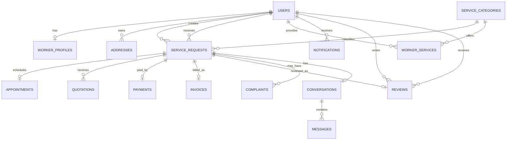

# SALE7LI Architecture

## Roles
- Customer: discovers services, creates requests, selects address/time, tracks work, accepts quotations, pays in the demo flow, reviews professionals.
- Worker: maintains professional profile, receives/accepts assigned work, schedules jobs, updates the service state, submits quotations, records completion evidence, communicates with the customer.
- Admin: monitors KPIs, manages users, verifies workers, manages service categories, assigns requests.

## Request state machine
`pending -> accepted -> scheduled -> on_the_way -> in_progress -> completed`

Terminal states: `cancelled`, `rejected`.

The transition is enforced by `App\Services\RequestWorkflow`; controllers should not directly invent arbitrary status transitions.

## Authorization principle
Every customer/worker request action is checked against the authenticated user's relationship to the request. Admin actions are protected with the `role:admin` middleware. This is intended to prevent IDOR-style access through guessed IDs.

## Data model

## Bilingual UI
Locale is stored on the user and mirrored into the session. The `SetLocale` web middleware sets the application locale on every request. All public service categories carry both English and Arabic labels/descriptions. The root layout switches `dir` between `ltr` and `rtl`.

## Payment boundary
The current controller deliberately implements a mock/test payment transaction. It creates a payment record and an invoice but does not collect or persist card numbers, CVV, expiry or other raw card data.
